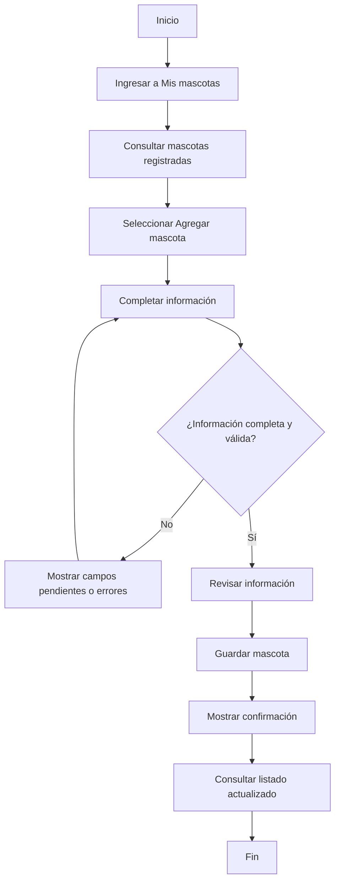
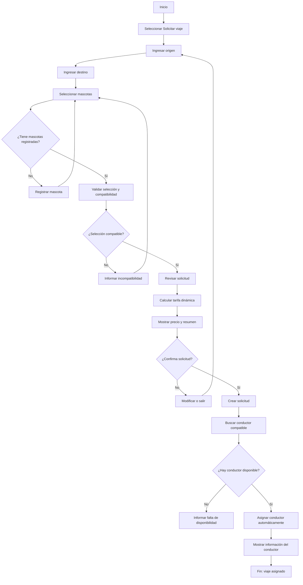
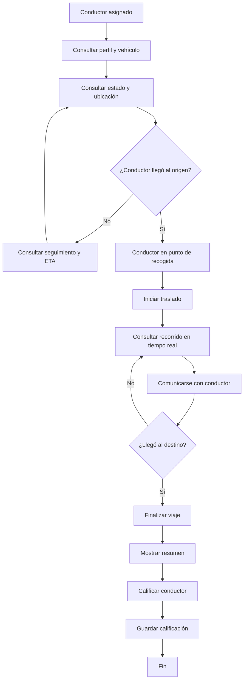

# PetRide — Documento de definición de producto y especificación funcional

**Versión:** 1.0  
**Estado:** Base funcional para prototipado  
**Propósito:** servir como documento de contexto y guía de implementación del prototipo de PetRide en Claude.

---

## 1. Alcance del documento

Este documento consolida la definición conceptual y funcional de PetRide, con un alcance deliberadamente limitado a **tres user flows**:

1. Registro de mascota.
2. Solicitar viaje.
3. Gestionar viaje.

El prototipo debe representar las pantallas, interacciones, decisiones, validaciones, estados y transiciones necesarias para ejecutar esos tres recorridos.

### Fuera del alcance

No se construirá una aplicación comercial completa. Quedan fuera de este prototipo:

- Flujos completos de registro, inicio de sesión y recuperación de contraseña.
- Administración completa de cuenta y configuración.
- Desarrollo completo de historial de viajes.
- Backend, base de datos o integraciones reales.
- Geolocalización, asignación de conductores o seguimiento GPS reales.
- Aplicación o panel para conductores.
- Infraestructura real de pagos.
- Servicios veterinarios, ambulancia animal o transporte intermunicipal.
- Funcionalidades independientes que no formen parte de los tres flujos.

Las pantallas auxiliares solo se incluirán cuando sean necesarias para completar alguno de los tres recorridos.

---

## 2. Contexto del producto

PetRide es una propuesta de aplicación móvil de movilidad especializada para personas que necesitan desplazarse acompañadas por sus animales domésticos de compañía.

El servicio conecta a usuarios con conductores preparados para realizar traslados urbanos, considerando las características de los animales y las condiciones del vehículo.

### Alcance del servicio

| Variable | Definición |
|---|---|
| Mercado | Principales ciudades de Colombia |
| Plataforma | Aplicación móvil |
| Modalidad | Viajes urbanos inmediatos |
| Usuarios | Personas que necesitan desplazarse con animales domésticos de compañía |
| Animales | Animales domésticos, sujetos a compatibilidad y condiciones de transporte |
| Modelo | Conexión entre usuarios y conductores compatibles |
| Asignación | Automática y aleatoria entre conductores disponibles y compatibles |
| Tarifa | Calculada por la aplicación de forma dinámica |
| Programación | No se contemplan viajes programados en el MVP |

Los traslados pueden responder a diferentes situaciones cotidianas: visitas veterinarias, estética y cuidado, parques y recreación, desplazamientos entre lugares, viajes hacia o desde terminales y aeropuertos, y otros recorridos urbanos. PetRide no es un servicio de ambulancia ni de atención veterinaria.

Los animales de asistencia deben tratarse de manera diferenciada y respetando sus protecciones y condiciones legales; no deben excluirse automáticamente por las restricciones comerciales aplicables a mascotas.

---

## 3. Problema, oportunidad y propuesta de valor

### Problema

Las personas que necesitan desplazarse con sus animales de compañía pueden encontrar dificultades para acceder a servicios de transporte que contemplen sus características y necesidades. La incertidumbre sobre la aceptación, las condiciones del vehículo y la disponibilidad de conductores adecuados puede generar fricción antes y durante el traslado.

### Oportunidad

Diseñar una experiencia de movilidad especializada que conecte a personas con animales de compañía con conductores preparados para realizar sus traslados, considerando las características de las mascotas desde la solicitud hasta la finalización del viaje.

### Propuesta de valor

**PetRide facilita la movilidad de personas con animales de compañía mediante un servicio de transporte especializado que conecta usuarios con conductores preparados, considerando las necesidades de cada mascota y las condiciones del traslado.**

---

## 4. Investigación y benchmark

### 4.1. Enfoque metodológico

La investigación del proyecto es exploratoria y conceptual. Se planteó a partir de:

1. Investigación secundaria sobre movilidad y transporte de animales de compañía.
2. Benchmark de plataformas de movilidad.
3. Análisis conceptual asistido por IA para construir escenarios, necesidades y posibles comportamientos.

**Limitación metodológica:** no se realizaron entrevistas, encuestas ni pruebas con usuarios reales. El arquetipo, mapa de empatía, Customer Journey e insights de usuario de este documento son hipótesis de diseño, no resultados validados.

### 4.2. Benchmark competitivo

El benchmark se limita a tres referentes:

#### Cabify Mascotas

- Categoría específica para viajar con mascotas.
- En Colombia, su disponibilidad se ha documentado en Bogotá.
- Contempla condiciones particulares de seguridad, higiene y comodidad.
- La aceptación del traslado depende de las condiciones del servicio y de la participación del conductor.
- La información pública consultada describe principalmente el transporte de perros y gatos.

#### Uber Pet

- Categoría específica para solicitar viajes con mascotas.
- La disponibilidad depende de la ubicación.
- Presenta condiciones particulares para viajar con animales.
- La plataforma informa el precio antes de confirmar la solicitud y permite consultar datos del conductor y seguimiento del viaje.
- Las condiciones sobre cantidad y tipo de animales deben revisarse según la ciudad y las políticas vigentes.

#### inDrive

- Plataforma de movilidad con un modelo de negociación de tarifas entre pasajeros y conductores.
- Permite comparar ofertas y perfiles de conductores.
- No se identificó una categoría especializada para mascotas en la oferta considerada para este benchmark.
- La aceptación de animales puede depender de la coordinación y disposición del conductor.

**Nota:** la disponibilidad, cobertura y políticas de estas plataformas pueden cambiar. El benchmark es una referencia conceptual y no debe utilizarse como afirmación de cobertura vigente para todas las ciudades.

### 4.3. Hallazgos del benchmark

1. La especialización permite comunicar con mayor claridad que un servicio admite mascotas.
2. La aceptación del conductor y las condiciones del vehículo son factores relevantes.
3. Conocer las condiciones del traslado antes de confirmar reduce incertidumbre.
4. Las características, cantidad y tamaño de los animales afectan la compatibilidad.
5. La selección y transparencia sobre el conductor contribuyen a la confianza.

### 4.4. Oportunidades para PetRide

- Registrar las características de cada mascota.
- Considerar la compatibilidad desde el inicio de la solicitud.
- Informar anticipadamente el precio y las condiciones del traslado.
- Mostrar información del conductor y del vehículo.
- Facilitar comunicación y seguimiento durante el recorrido.
- Permitir varias mascotas en una solicitud cuando la capacidad y compatibilidad lo permitan.

---

## 5. Análisis del usuario

### 5.1. Arquetipo principal

**Arquetipo hipotético:** persona que necesita movilizarse con su animal doméstico de compañía.

Persona que vive en una ciudad colombiana y considera a su animal de compañía parte de su vida cotidiana. Necesita desplazarse con él para atender responsabilidades, acceder a servicios o realizar actividades personales.

**Necesidades hipotéticas**

- Encontrar transporte que acepte a su mascota.
- Conocer anticipadamente las condiciones del servicio.
- Identificar conductores y vehículos adecuados.
- Saber cuánto costará el traslado.
- Mantenerse informado durante el viaje.

**Motivaciones hipotéticas**

- Procurar el bienestar de su mascota.
- Evitar inconvenientes al solicitar transporte convencional.
- Ahorrar tiempo buscando alternativas.
- Tener mayor seguridad y previsibilidad.

**Frustraciones hipotéticas**

- No saber si un conductor aceptará transportar a su mascota.
- Tener que explicar repetidamente sus necesidades.
- Encontrar restricciones relacionadas con tamaño o cantidad de animales.
- Desconocer las condiciones del vehículo.
- Sentir incertidumbre durante la espera y el recorrido.

### 5.2. Mapa de empatía

**Piensa y siente**
- Quiere que su mascota viaje cómoda y segura.
- Le preocupa que el conductor rechace el traslado.
- Necesita claridad sobre las condiciones del servicio.
- Quiere evitar imprevistos.

**Ve**
- Aplicaciones de movilidad que no siempre ofrecen opciones específicas para mascotas.
- Restricciones sobre tamaño, tipo o cantidad de animales.
- Alternativas con diferentes niveles de especialización.

**Escucha**
- Recomendaciones sobre servicios que aceptan mascotas.
- Experiencias de rechazo por parte de conductores.
- Consejos para preparar animales para viajar.

**Dice y hace**
- Pregunta si puede viajar con su mascota antes de solicitar.
- Busca alternativas cuando las aplicaciones convencionales no responden a su necesidad.
- Explica características de su mascota.
- Prepara al animal según las condiciones del traslado.

**Esfuerzos y frustraciones**
- Perder tiempo buscando transporte.
- Tener que negociar o justificar la presencia de la mascota.
- No conocer las condiciones del vehículo.
- Descubrir restricciones demasiado tarde.

**Resultados esperados**
- Encontrar un servicio adecuado.
- Conocer condiciones y precio antes de confirmar.
- Tener un conductor preparado.
- Comunicarse durante el viaje.
- Completar el recorrido sin inconvenientes.

### 5.3. Insight de diseño

> Cuando necesito desplazarme con mi mascota, no solo busco un vehículo que me lleve a un destino. Necesito tener la certeza de que el conductor y las condiciones del traslado son adecuados para ella.

Este insight es una hipótesis de diseño y no un hallazgo validado con usuarios.

### 5.4. Customer Journey Map

**Escenario:** una persona necesita desplazarse con su mascota dentro de una ciudad colombiana y utiliza PetRide para solicitar un viaje inmediato.

| Etapa | Acción | Pensamiento hipotético | Emoción hipotética | Oportunidad |
|---|---|---|---|---|
| Surge la necesidad | Identifica destino y necesidad de transporte | ¿Dónde consigo un vehículo que acepte a mi mascota? | Incertidumbre | Comunicar qué resuelve PetRide |
| Explora el servicio | Ingresa y consulta la aplicación | ¿El servicio tiene las condiciones que necesito? | Expectativa | Explicar funcionamiento y condiciones |
| Configura el traslado | Indica origen, destino y mascotas | ¿Encontraré un conductor adecuado? | Expectativa e incertidumbre | Considerar características y compatibilidad |
| Espera asignación | Espera la búsqueda del conductor | ¿Quién realizará el viaje? | Expectativa | Mostrar estados claros y datos del conductor |
| Realiza el viaje | Se encuentra con el conductor y realiza el recorrido | Quiero saber que todo transcurre bien | Tranquilidad esperada | Facilitar chat y seguimiento |
| Finaliza y evalúa | Llega y califica el servicio | ¿Cómo fue nuestra experiencia? | Satisfacción o inconformidad | Facilitar calificación |

**Insight del recorrido:** la confianza debe construirse antes de solicitar el viaje y mantenerse durante todo el servicio.

### 5.5. Síntesis de problemas y oportunidades

| Problema hipotético | Oportunidad |
|---|---|
| Disponibilidad incierta | Servicio especializado |
| Falta de información | Comunicar condiciones antes de confirmar |
| Compatibilidad limitada | Considerar mascota, conductor y vehículo |
| Comunicación insuficiente | Chat con el conductor |
| Incertidumbre durante el viaje | Seguimiento y estados claros |

---

## 6. Definición del producto

### 6.1. Concepto

PetRide es una aplicación móvil de movilidad especializada que conecta a personas con animales domésticos de compañía con conductores preparados para realizar traslados urbanos inmediatos.

### 6.2. Objetivos del producto

1. Facilitar que las personas soliciten transporte junto a sus mascotas.
2. Mejorar la compatibilidad entre características de los animales y condiciones de los vehículos.
3. Generar confianza mediante información clara del conductor, vehículo y servicio.
4. Acompañar el traslado mediante comunicación y seguimiento.
5. Recoger la evaluación del servicio al finalizar.

### 6.3. Actores

| Actor | Responsabilidad |
|---|---|
| Usuario | Registra mascotas y solicita traslados |
| Conductor | Acepta y realiza viajes para los que está preparado |
| PetRide | Gestiona solicitud, compatibilidad, asignación y seguimiento |

### 6.4. MVP y funcionalidades dentro de los tres flujos

- Registro y consulta de perfiles de mascotas.
- Solicitud de viajes inmediatos.
- Selección de una o varias mascotas.
- Evaluación de compatibilidad.
- Cálculo y presentación de tarifa.
- Asignación automática de conductor.
- Consulta de perfil del conductor y vehículo.
- Chat con el conductor.
- Seguimiento del viaje.
- Finalización y calificación.

El historial puede aparecer como referencia secundaria después de completar un viaje, pero no constituye un flujo independiente del prototipo.

---

## 7. Reglas de negocio para los tres flujos

Estas reglas describen el comportamiento conceptual del prototipo. No representan una operación comercial o técnica real.

### 7.1. Registro de mascota

- El usuario puede registrar varias mascotas.
- Cada mascota tiene un perfil individual.
- Información mínima: nombre, especie, tamaño y peso aproximado.
- Raza, fotografía y observaciones son opcionales.
- La información debe ayudar a evaluar compatibilidad del traslado.
- El perfil registrado queda disponible para seleccionarse en una solicitud.

### 7.2. Solicitud y compatibilidad

- PetRide permite únicamente viajes urbanos inmediatos.
- El usuario indica origen y destino.
- Debe seleccionar al menos una mascota.
- Puede seleccionar varias si el vehículo tiene capacidad y cumple las condiciones.
- La compatibilidad considera especie, tamaño, peso, cantidad y condiciones relevantes.
- Las condiciones de transporte y seguridad deben comunicarse antes de confirmar.
- Si no existe compatibilidad, se informa al usuario y se permite modificar la selección.

### 7.3. Tarifa

- La tarifa la calcula PetRide.
- El cálculo es dinámico y considera distancia, condiciones del traslado y demanda.
- El precio se presenta antes de confirmar.
- Si cambia la información relevante del viaje, el precio debe recalcularse antes de la confirmación.
- El prototipo puede utilizar valores simulados y coherentes; no requiere motor tarifario real.

### 7.4. Asignación

- La asignación es automática y aleatoria entre conductores disponibles y compatibles.
- El usuario no elige conductor.
- La compatibilidad debe evaluarse antes de incluir un conductor en la selección.
- Si un conductor rechaza, el sistema puede continuar buscando otro.
- Cuando un conductor acepta, se muestra su información.
- Si no hay conductores compatibles, se informa que no fue posible asignar el viaje.

### 7.5. Cancelación

- Existe una ventana de cancelación gratuita.
- Después de esa ventana puede aplicarse un cargo.
- Antes de confirmar la cancelación, la aplicación informa si existe un cargo.
- La duración de la ventana y el importe son parámetros configurables; no se inventan valores para el prototipo.

### 7.6. Gestión del viaje

Estados del viaje:

1. Buscando conductor.
2. Conductor asignado.
3. Conductor en camino.
4. Conductor en punto de recogida.
5. Viaje en curso.
6. Viaje finalizado.
7. Viaje cancelado.

El viaje no comienza automáticamente cuando el conductor llega; debe existir una transición explícita a viaje en curso. La finalización debe reflejarse en el resumen y habilitar la calificación.

### 7.7. Seguridad y animales

- Se contemplan animales domésticos sujetos a compatibilidad y condiciones de transporte.
- Las condiciones pueden requerir transportadora, guacal, arnés u otros elementos, según especie y características.
- El usuario debe proporcionar información correcta sobre sus animales.
- Los animales de asistencia deben tratarse de forma diferenciada, respetando sus protecciones y condiciones legales.
- PetRide no es un servicio veterinario ni una ambulancia animal.

---

## 8. Arquitectura de información limitada a los tres flujos

La arquitectura se mantiene enfocada en los recorridos que serán prototipados.

### Entradas principales

- Inicio: acceso a solicitar viaje y a las mascotas registradas.
- Mis mascotas: acceso al registro y consulta de perfiles.
- Solicitar viaje: entrada al flujo de solicitud.
- Viaje activo: acceso contextual al flujo de gestión.

### Relaciones

- El usuario puede iniciar el registro desde Mis mascotas.
- Si intenta solicitar un viaje sin mascotas registradas, puede entrar al registro y regresar a la solicitud.
- La selección de mascotas ocurre dentro de Solicitar viaje.
- Al confirmar una solicitud, comienza la búsqueda y asignación.
- Una vez asignado el conductor, comienza Gestionar viaje.
- Al finalizar, el usuario consulta el resumen y califica.

No se define una navegación completa de una aplicación comercial fuera de estas necesidades.

---

# 9. User Flow 01 — Registro de mascota

## 9.1. Objetivo

Permitir que el usuario registre una o varias mascotas en PetRide y almacene la información necesaria para considerarlas durante la solicitud y asignación de un viaje.

## 9.2. Flujo principal

## 9.3. Pantallas

### Pantalla 01. Mis mascotas

**Objetivo:** consultar perfiles registrados y acceder a la creación de nuevos.

**Contenido**
- Título «Mis mascotas».
- Listado de mascotas registradas.
- Fotografía o imagen identificadora.
- Nombre y especie.
- Acceso para consultar cada perfil.
- Botón «Agregar mascota».

**Acciones**
- Consultar una mascota.
- Agregar una mascota.
- Editar un perfil existente.

**Estados**
- Con mascotas: mostrar listado.
- Sin mascotas: estado vacío y acceso para registrar la primera.
- Cargando: indicador de carga.
- Error: informar y permitir reintentar.

### Pantalla 02. Registrar mascota

**Objetivo:** recopilar la información necesaria del animal.

| Campo | Tipo | Requerido |
|---|---|---|
| Fotografía | Carga de imagen | No |
| Nombre | Texto | Sí |
| Especie | Selector | Sí |
| Raza | Texto o selector | No |
| Tamaño | Selector | Sí |
| Peso aproximado | Numérico | Sí |
| Observaciones | Texto | No |

**Acciones**
- Cargar fotografía.
- Completar información.
- Seleccionar especie y tamaño.
- Continuar a revisión.
- Cancelar.

**Validaciones**
- Nombre obligatorio.
- Especie obligatoria.
- Tamaño obligatorio.
- Peso numérico y mayor que cero.
- Identificar campos obligatorios.
- Conservar información ingresada si ocurre un error.

**Estados**
- Inicial: formulario vacío.
- En edición: usuario completa campos.
- Error: identificar campos por corregir.
- Imagen cargada: mostrar fotografía.
- Imagen no válida: informar y permitir otra selección.

### Pantalla 03. Revisar información

**Objetivo:** verificar los datos antes de guardar.

**Contenido**
- Fotografía.
- Nombre.
- Especie.
- Raza, si existe.
- Tamaño.
- Peso aproximado.
- Observaciones, si existen.

**Acciones**
- Editar información.
- Confirmar y guardar.

**Comportamiento**
- Editar regresa al formulario conservando los datos.
- Confirmar guarda el perfil.
- Evitar duplicados por múltiples pulsaciones.

### Pantalla 04. Confirmación de registro

**Objetivo:** confirmar que el perfil quedó registrado.

**Contenido**
- Mensaje «¡Tu mascota ha sido registrada!».
- Nombre y fotografía.
- Acceso al perfil.
- Opción para registrar otra mascota.
- Opción para regresar a Mis mascotas.

**Acciones**
- Ver perfil.
- Agregar otra mascota.
- Volver a Mis mascotas.

**Resultado:** el perfil queda disponible para la solicitud de viaje.

### Pantalla 05. Detalle de mascota

**Objetivo:** consultar el perfil registrado.

**Contenido**
- Fotografía.
- Nombre.
- Especie.
- Raza.
- Tamaño.
- Peso.
- Observaciones.

**Acciones**
- Editar perfil.
- Regresar al listado.

### Pantalla 06. Editar mascota

**Objetivo:** actualizar la información existente.

**Comportamiento**
- Mostrar datos actuales.
- Permitir modificar campos.
- Aplicar las validaciones del registro.
- Guardar cambios o cancelar.
- Confirmar cuando los cambios se hayan guardado.

## 9.4. Caminos alternativos

| Situación | Comportamiento |
|---|---|
| No hay mascotas registradas | Mostrar estado vacío y acceso para agregar |
| Usuario cancela | Salir sin guardar |
| Información incompleta | Identificar campos pendientes |
| Error al guardar | Conservar los datos e informar |
| Usuario edita perfil | Abrir formulario con datos existentes |

**Resultado del flujo:** una mascota queda registrada y disponible para seleccionarse en una solicitud.

---

# 10. User Flow 02 — Solicitar viaje

## 10.1. Objetivo

Permitir que el usuario configure y confirme un traslado inmediato con una o varias mascotas, consulte el precio y solicite la asignación automática de un conductor compatible.

## 10.2. Flujo principal

## 10.3. Pantallas

### Pantalla 01. Definir origen y destino

**Objetivo:** identificar dónde comienza y termina el traslado.

**Contenido**
- Campo de origen.
- Campo de destino.
- Mapa.
- Ubicación actual como opción de origen.
- Búsqueda de direcciones.

**Acciones**
- Seleccionar origen.
- Seleccionar destino.
- Buscar direcciones.
- Modificar ubicaciones.

**Validaciones**
- Ambos campos son obligatorios.
- Las ubicaciones deben ser válidas.
- Origen y destino no pueden ser iguales.

**Estados**
- Inicial: campos vacíos.
- Buscando: mostrar resultados.
- Seleccionada: mostrar dirección confirmada.
- Error: informar si no se encuentra dirección.

### Pantalla 02. Seleccionar mascotas

**Objetivo:** elegir los animales que viajarán.

**Contenido**
- Listado de mascotas registradas.
- Fotografía, nombre, especie y tamaño.
- Selector individual.
- Indicador de seleccionadas.
- Acceso para registrar otra mascota.

**Acciones**
- Seleccionar una o varias.
- Retirar una de la selección.
- Registrar otra mascota.

**Validaciones**
- Seleccionar al menos una.
- Evaluar compatibilidad con el vehículo.
- Considerar capacidad para todos los animales.

**Estados**
- Sin mascotas: acceso al registro.
- Sin selección: solicitar selección.
- Selección válida: permitir continuar.
- Selección incompatible: explicar la condición y permitir modificar.

### Pantalla 03. Revisar solicitud

**Objetivo:** revisar la información antes de calcular y presentar la tarifa.

**Contenido**
- Origen.
- Destino.
- Mascotas seleccionadas.
- Características relevantes.
- Distancia estimada.
- Condiciones relevantes del traslado.

**Acciones**
- Modificar origen.
- Modificar destino.
- Cambiar mascotas.
- Continuar.

**Comportamiento:** cualquier cambio actualiza los datos utilizados para evaluar compatibilidad y calcular la tarifa.

### Pantalla 04. Consultar tarifa

**Objetivo:** presentar el precio calculado por PetRide antes de confirmar.

**Contenido**
- Precio total.
- Origen y destino.
- Mascotas seleccionadas.
- Resumen del traslado.

**Reglas**
- La aplicación calcula la tarifa.
- Considera distancia, condiciones del traslado y demanda.
- Presenta el precio antes de confirmar.
- Si cambian las condiciones, recalcula.
- El usuario conoce el precio que acepta.

**Acciones**
- Confirmar solicitud.
- Regresar y modificar datos.

### Pantalla 05. Confirmar solicitud

**Objetivo:** obtener la confirmación para iniciar la búsqueda.

**Contenido**
- Resumen del viaje.
- Precio final.
- Mascotas incluidas.
- Botón «Confirmar viaje».

**Acciones**
- Confirmar.
- Regresar a modificar.

**Comportamiento**
- Al confirmar se crea la solicitud.
- Comienza la búsqueda automática.
- Evitar solicitudes duplicadas por pulsaciones repetidas.

### Pantalla 06. Buscando conductor

**Objetivo:** informar que PetRide busca un conductor disponible y compatible.

**Contenido**
- Estado de búsqueda.
- Resumen del viaje.
- Origen y destino.
- Mascotas.
- Precio confirmado.
- Opción de cancelar.

**Comportamiento**
- Buscar conductores disponibles y compatibles.
- Asignar automáticamente y de forma aleatoria entre los candidatos que cumplen las condiciones.
- Si un conductor rechaza, continuar buscando otro.
- Cuando uno acepta, mostrar su información.

**Estados**
- Buscando.
- Reintentando asignación.
- Conductor asignado.
- Sin disponibilidad.
- Solicitud cancelada.

### Pantalla 07. Sin disponibilidad

**Objetivo:** informar que no se encontró un conductor compatible.

**Contenido**
- Mensaje «No encontramos conductores disponibles para tu viaje».
- Explicación breve.
- Resumen de la solicitud.

**Acciones**
- Intentar nuevamente.
- Modificar solicitud.
- Volver al inicio del prototipo.

**Comportamiento:** un nuevo intento inicia otra búsqueda; no se garantiza disponibilidad.

## 10.4. Caminos alternativos

| Situación | Comportamiento |
|---|---|
| No hay mascotas registradas | Abrir registro y regresar a la solicitud |
| No selecciona mascotas | Impedir continuar |
| Selección incompatible | Informar y permitir modificar |
| No hay conductores | Informar falta de disponibilidad |
| Usuario modifica origen/destino | Recalcular tarifa y compatibilidad |
| Usuario no confirma | Permitir modificar o salir |
| Conductor rechaza | Continuar buscando otro compatible |

**Resultado del flujo:** solicitud asignada a un conductor compatible, con información del conductor y vehículo disponible para iniciar la gestión del viaje.

---

# 11. User Flow 03 — Gestionar viaje

## 11.1. Objetivo

Permitir que el usuario gestione el traslado desde que un conductor acepta la solicitud hasta que el viaje termina y el usuario califica el servicio.

## 11.2. Flujo principal

## 11.3. Pantallas

### Pantalla 01. Conductor asignado

**Objetivo:** confirmar la asignación y presentar información del conductor.

**Contenido**
- Mensaje de confirmación.
- Fotografía y nombre.
- Calificación.
- Marca, modelo, color y placa del vehículo.
- Tiempo estimado de llegada.
- Origen y destino.
- Mascotas incluidas.

**Acciones**
- Contactar al conductor.
- Consultar ubicación.
- Cancelar viaje.

**Comportamiento**
- Mantener disponibles los datos durante el viaje.
- Si el conductor cancela antes de la recogida, iniciar nueva búsqueda compatible o informar falta de disponibilidad.

### Pantalla 02. Conductor en camino

**Objetivo:** permitir seguir la llegada del conductor.

**Contenido**
- Mapa.
- Ubicación del conductor.
- Punto de recogida.
- Tiempo estimado de llegada.
- Información del conductor y vehículo.
- Estado «Tu conductor está en camino».
- Acceso al chat.
- Opción de cancelar.

**Acciones**
- Consultar ubicación.
- Comunicarse.
- Cancelar.

**Estados**
- Actualizando ubicación.
- Conductor en camino.
- Error de ubicación.
- Conductor llegó.

### Pantalla 03. Conductor en punto de recogida

**Objetivo:** informar que el conductor llegó y facilitar la coordinación.

**Contenido**
- Mensaje «Tu conductor llegó».
- Ubicación del vehículo.
- Datos del conductor.
- Datos del vehículo.
- Acceso al chat.
- Información del tiempo de espera, si aplica.

**Acciones**
- Contactar al conductor.
- Consultar vehículo.
- Cancelar según las condiciones aplicables.

**Comportamiento**
- Cambiar el estado cuando el conductor reporta su llegada.
- Permitir coordinar la recogida.
- No iniciar automáticamente el viaje por el solo hecho de que el conductor llegó.

### Pantalla 04. Viaje en curso

**Objetivo:** mostrar el recorrido y mantener informado al usuario.

**Contenido**
- Mapa con ruta.
- Ubicación actual.
- Destino.
- Información resumida del conductor.
- Mascotas incluidas.
- Estado «Viaje en curso».
- Acceso al chat.
- Acceso a reportar un inconveniente.

**Acciones**
- Consultar recorrido.
- Comunicarse con el conductor.
- Consultar destino.
- Reportar inconveniente.

**Comportamiento**
- Simular actualización de ubicación en el prototipo.
- Cambiar estado al finalizar.
- Ofrecer acceso al reporte ante un inconveniente.

### Pantalla 05. Chat con conductor

**Objetivo:** facilitar la comunicación durante la coordinación y el traslado.

**Contenido**
- Nombre y fotografía del conductor.
- Conversación.
- Campo para escribir.
- Botón para enviar.
- Indicadores de envío y recepción.

**Acciones**
- Escribir.
- Enviar.
- Consultar mensajes anteriores.

**Estados**
- Conversación activa.
- Enviando.
- Error de envío con opción de reintentar.
- Viaje finalizado: conversación en modo consulta, si el prototipo lo contempla.

### Pantalla 06. Viaje finalizado

**Objetivo:** confirmar que el traslado terminó y presentar un resumen.

**Contenido**
- Mensaje «¡Llegaste a tu destino!».
- Origen y destino.
- Fecha y hora.
- Mascotas transportadas.
- Información del conductor.
- Valor cobrado o valor simulado.
- Acceso a calificar.

**Acciones**
- Calificar conductor.
- Consultar resumen.
- Continuar al cierre del flujo.

**Comportamiento**
- Cambiar el viaje a estado finalizado.
- Registrar el viaje en el estado simulado del prototipo.
- Habilitar calificación.

### Pantalla 07. Calificar conductor

**Objetivo:** recopilar la evaluación del servicio.

**Contenido**
- Fotografía y nombre.
- Calificación por estrellas.
- Comentario opcional.
- Botón «Enviar calificación».

**Acciones**
- Seleccionar puntuación.
- Escribir comentario.
- Enviar evaluación.

**Validaciones**
- Puntuación obligatoria para enviar.
- Comentario opcional.
- Evitar evaluaciones duplicadas.

**Resultado:** evaluación asociada al viaje en el estado del prototipo.

## 11.4. Cancelación como acción contextual

La cancelación no constituye un user flow independiente.

**Comportamiento**
1. El usuario selecciona «Cancelar viaje».
2. La aplicación presenta las condiciones.
3. Informa si es gratuita o si puede generar un cargo.
4. El usuario confirma o regresa.
5. Si confirma, el estado cambia a «Viaje cancelado».

La duración de la ventana gratuita y el importe son parámetros configurables.

## 11.5. Caminos alternativos

| Situación | Comportamiento |
|---|---|
| Conductor cancela antes de recoger | Buscar nuevo conductor compatible |
| No se encuentra reemplazo | Informar falta de disponibilidad |
| Usuario cancela | Aplicar regla de cancelación |
| Conductor no llega | Permitir reportar y gestionar |
| Usuario no está en origen | Mostrar procedimiento de espera configurado |
| Problema durante traslado | Facilitar comunicación y reporte |
| Error de ubicación | Mostrar última ubicación y advertir que puede estar desactualizada |

**Resultado del flujo:** viaje finalizado, resumen presentado y calificación registrada en el prototipo.

---

## 12. Estados e interacciones transversales

Estos estados se implementan solo cuando afecten alguno de los tres recorridos.

### 12.1. Conexión

- Si se pierde conexión, informar al usuario.
- Conservar los datos ingresados.
- Al recuperar conexión, actualizar el estado simulado.
- Evitar duplicar registros o solicitudes.

### 12.2. Ubicación

- Si no hay permiso, permitir ingreso manual de direcciones en la solicitud.
- Si una dirección no se encuentra, permitir modificarla.
- Si la ubicación del conductor no se actualiza, mostrar última posición y advertencia.
- En el prototipo, las ubicaciones y movimientos son simulados.

### 12.3. Registro de mascota

- Identificar campos obligatorios.
- Conservar datos ante errores.
- Permitir continuar sin fotografía.
- Evitar duplicados al guardar.

### 12.4. Solicitud

- No permitir continuar sin origen, destino y al menos una mascota.
- Evaluar compatibilidad antes de mostrar confirmación.
- Actualizar tarifa cuando cambien condiciones relevantes.
- Evitar solicitudes duplicadas.
- Mostrar estados reales de la simulación.

### 12.5. Viaje

- Sincronizar estado y pantalla.
- No mostrar conductor asignado hasta que la simulación confirme la asignación.
- No iniciar viaje automáticamente al llegar el conductor.
- No finalizar sin la transición correspondiente.
- Habilitar calificación después de finalizar.

### 12.6. Reporte de inconvenientes

El prototipo puede ofrecer una acción para reportar un problema durante el viaje. No es necesario construir un centro de soporte completo; basta con representar la acción, una selección sencilla de motivo y una confirmación de recepción simulada.

---

# 13. Indicaciones de implementación del prototipo en Claude

## 13.1. Alcance

Construir un prototipo navegable que represente únicamente los tres user flows documentados. Priorizar coherencia funcional, transiciones claras y estados interactivos.

No construir backend, servicios reales, autenticación completa, pagos reales ni herramientas para conductores.

## 13.2. Diagramas interactivos de user flows

Los diagramas de los tres flujos deben implementarse como **estructuras dinámicas e interactivas**, no como imágenes estáticas.

La experiencia debe permitir:

- Explorar cada paso del flujo.
- Identificar decisiones y sus alternativas.
- Visualizar ramificaciones.
- Entender las conexiones entre pantallas.
- Diferenciar el camino principal de los caminos alternativos.
- Seleccionar un nodo y consultar su descripción o pantalla relacionada.
- Mantener una relación clara entre el diagrama y la experiencia prototipada.

Los diagramas deben conservar la estructura real de cada flujo. No simplificar decisiones ni eliminar caminos alternativos relevantes.

## 13.3. Simulación del seguimiento del viaje

La pantalla de viaje en curso debe incluir una simulación interactiva:

- Mapa o representación de una ruta.
- Vehículo que avanza progresivamente por el recorrido.
- Actualización de estados: conductor en camino, llegó al origen, viaje en curso y viaje finalizado.
- Transiciones que permitan observar cómo evoluciona el servicio.
- Al completar el recorrido, mostrar el resumen y conducir a la calificación.

No requiere GPS, mapas conectados ni conductores reales. Debe ser una simulación local, consistente y controlable dentro del prototipo.

## 13.4. Datos simulados

Utilizar datos ficticios y consistentes para:

- Mascotas.
- Direcciones.
- Conductores.
- Vehículos.
- Calificaciones.
- Tarifas.
- Ubicación y recorrido.

Evitar presentar datos ficticios como información real de servicios o usuarios.

## 13.5. Criterios de calidad

- Cada pantalla debe tener un objetivo funcional claro.
- Los botones deben producir acciones y transiciones reales dentro del prototipo.
- Los formularios deben validar los campos definidos.
- Los estados deben ser visibles y coherentes.
- Las acciones de volver y editar deben conservar los datos cuando corresponda.
- No crear pantallas o funcionalidades ajenas a los tres flujos.
- Mantener consistencia entre diagramas, pantallas y reglas de negocio.

---

# 14. Parámetros configurables y decisiones no implementadas

Para evitar inventar políticas comerciales, los siguientes valores quedan como parámetros configurables o datos simulados:

| Parámetro | Tratamiento en el prototipo |
|---|---|
| Duración de cancelación gratuita | Configurable |
| Cargo posterior a la ventana gratuita | Valor simulado/configurable |
| Fórmula exacta de tarifa dinámica | Simulación basada en distancia, condiciones y demanda |
| Capacidad máxima por vehículo | Regla de compatibilidad simulada |
| Tiempo máximo de espera | Configurable |
| Tiempo estimado de llegada | Simulado |
| Medios y procesamiento de pago | Fuera del alcance |
| Geolocalización | Simulada |
| Asignación de conductores | Simulada, automática y aleatoria entre candidatos compatibles |

No se deben inventar cifras como reglas definitivas. Si se necesitan valores para demostrar el prototipo, identificarlos como datos de ejemplo.

---

# 15. Checklist de cierre

- [x] Contexto y problema del producto.
- [x] Oportunidad y propuesta de valor.
- [x] Benchmark competitivo: Cabify Mascotas, Uber Pet e inDrive.
- [x] Arquetipo hipotético.
- [x] Mapa de empatía hipotético.
- [x] Customer Journey Map hipotético.
- [x] Síntesis de problemas y oportunidades.
- [x] Objetivos y alcance del MVP.
- [x] Reglas de negocio necesarias para los tres flujos.
- [x] Arquitectura de información enfocada en los tres flujos.
- [x] User Flow 01: Registro de mascota.
- [x] User Flow 02: Solicitar viaje.
- [x] User Flow 03: Gestionar viaje.
- [x] Especificación funcional de pantallas.
- [x] Estados, validaciones y caminos alternativos.
- [x] Nota de diagramas interactivos.
- [x] Nota de simulación del recorrido del vehículo.
- [x] Delimitación de lo que queda fuera del prototipo.

**Documento consolidado:** esta especificación constituye la base funcional de PetRide para iniciar el prototipado. Las decisiones y reglas son una base de trabajo flexible: cualquier modificación durante la implementación debe revisarse frente a los flujos y pantallas relacionados antes de actualizar la especificación.
